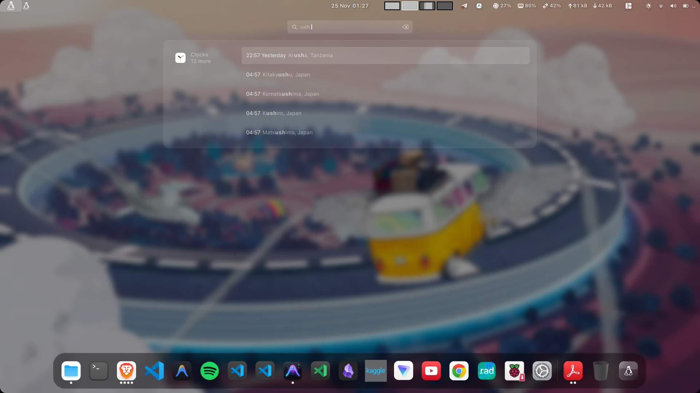
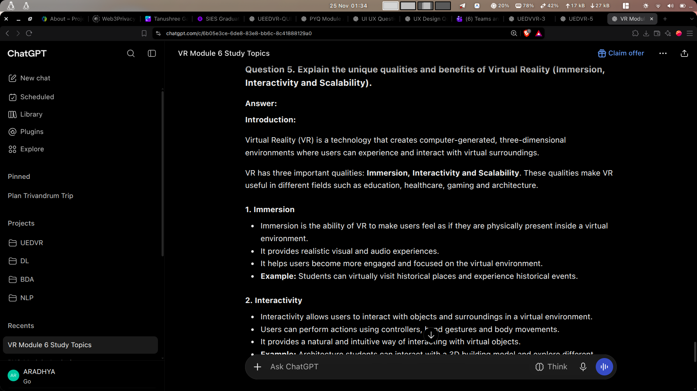
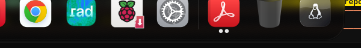
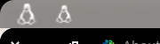

<div align="center">

# 🐧 GNOME Modern macOS Aesthetic Rice (Tux Edition)

### Transform your Ubuntu / GNOME Desktop into an Ultra-Refined, Glassmorphic macOS Experience with Native Linux Branding.

[](https://ubuntu.com)
[](https://www.gnome.org)
[](#)
[](LICENSE)

<br/>



*Activities Overview featuring hardware-accelerated rounded window shaders, frosted glass blur, curved screen bezels, and custom Linux Tux dock icon.*

</div>

---

## 📸 Visual Showcase

<div align="center">

### Clean Desktop View


<br/><br/>

### Custom Linux Tux Branding (Replacing Apple Logos)
| Floating Dock App Launcher | Top Bar Menu & Activities |
| :---: | :---: |
|  |  |
| *Vector Tux on a frosted macOS glass squircle* | *Crisp 16px monochrome Tux on top panel* |

</div>

---

## 🤖 One-Click Prompt for AI Coding Agents

If you are using an AI agent harness (such as **Antigravity**, **Claude Code**, **Cursor**, or **Aider**), simply copy and paste the prompt below into your agent:

```markdown
Run the modern macOS aesthetic setup on this Ubuntu GNOME desktop using the repository https://github.com/GauravPatil2515/gnome-desktop-customization.git:

1. Clone the repository into a temporary directory or workspace.
2. Set window titlebar buttons to the left in macOS order: gsettings set org.gnome.desktop.wm.preferences button-layout 'close,minimize,maximize:'.
3. Set Dash-to-Dock to a centered floating bottom dock: dock-position BOTTOM, extend-height false.
4. Replace WhiteSur theme Apple logos with the custom Linux Tux SVGs from the repo (both view-app-grid-tux.svg for dock and activities-tux.svg for the panel).
5. Add window corner border-radius (16px) into ~/.config/gtk-3.0/gtk.css and ~/.config/gtk-4.0/gtk.css.
6. If rounded-window-corners@fxgn is installed, compile its GSettings schemas to ~/.local/share/glib-2.0/schemas and enable rounding on maximized windows: keepRoundedCorners.maximized = true with borderRadius = 16.
7. Reload the GNOME Shell user-theme to immediately apply all changes without logging out.
```

---

## ⚡ Quickstart (Automated Script)

Run the included automated installer script in one command:

```bash
git clone https://github.com/GauravPatil2515/gnome-desktop-customization.git
cd gnome-desktop-customization
chmod +x install.sh
./install.sh
```

---

## 🎨 Architectural Overview

| Category | Component / Extension | Description & Configuration |
| :--- | :--- | :--- |
| **Window Layout** | Titlebar Controls | Left-hand traffic light arrangement (`close,minimize,maximize:`) |
| **GTK & Shell Theme** | `WhiteSur-Dark` | macOS Big Sur / Monterey dark-mode aesthetic with realistic depth |
| **Icon Theme** | `WhiteSur-dark` | Apple squircle vector icons with vibrant macOS gradients |
| **Typography** | `SF Pro Text 11` | Apple's official San Francisco typography for UI text |
| **Dock Launcher** | `dash-to-dock` | Floating, auto-centered bottom dock with running indicators |
| **Branding Replacement** | Custom Tux SVGs | Custom Linux Tux glass squircle replacing all Apple logos |
| **Window Corner Shaders** | `rounded-window-corners@fxgn` | 16px corner rounding on windows (including maximized & tiled) |
| **Display Bezel Curves** | `Rounded_Corners@lennart-k` | 16px curved display edges mimicking MacBook Liquid Retina bezels |
| **Acrylic Blur** | `blur-my-shell@aunetx` | Real-time GPU glassmorphism behind the dock, top bar, and overview |
| **Genie Animation** | `compiz-alike-magic-lamp-effect`| Fluid macOS Genie window minimize and restore motion |
| **Clean Desktop** | `ding` disabled | Spotless desktop workspace with zero icon clutter |

---

## 🛠️ Step-by-Step Manual Setup

### 1. Move Window Controls to Top-Left
Set the classic macOS "traffic light" position:

```bash
gsettings set org.gnome.desktop.wm.preferences button-layout 'close,minimize,maximize:'
```

### 2. Configure Floating Bottom Dock
Configure `dash-to-dock`:

```bash
gsettings set org.gnome.shell.extensions.dash-to-dock dock-position 'BOTTOM'
gsettings set org.gnome.shell.extensions.dash-to-dock extend-height false
gsettings set org.gnome.shell.extensions.dash-to-dock show-icons-emblems true
gsettings set org.gnome.shell.extensions.dash-to-dock show-icons-notifications-counter true
```

### 3. Replace Apple Logos with Linux Tux
The WhiteSur GNOME Shell theme bundles hardcoded SVGs inside its theme folder. Replace them with the custom Tux vector assets from this repository:

```bash
# Replace dock app-grid icon
cp assets/view-app-grid-tux.svg ~/.themes/WhiteSur-Dark/gnome-shell/assets/view-app-grid.svg

# Replace top-bar Activities & Application Menu icons
cp assets/activities-tux.svg ~/.themes/WhiteSur-Dark/gnome-shell/assets/activities.svg
cp assets/activities-tux.svg ~/.themes/WhiteSur-Dark/gnome-shell/assets/activities-white.svg

# Refresh user theme cache
gsettings set org.gnome.shell.extensions.user-theme name ''
sleep 0.5
gsettings set org.gnome.shell.extensions.user-theme name 'WhiteSur-Dark'
```

### 4. Enable GTK Window Border Radius
Ensure native GTK 3 & GTK 4 apps render with smooth 16px corners:

`~/.config/gtk-3.0/gtk.css`:
```css
decoration {
  border-radius: 16px;
}
```

`~/.config/gtk-4.0/gtk.css`:
```css
window, dialog {
  border-radius: 16px;
}
```

### 5. Hardware-Accelerated Rounded Window Corners (All Apps)
For non-GTK applications (Brave, Chrome, Electron, Qt, VS Code), install **Rounded Window Corners Reborn** (`rounded-window-corners@fxgn`):

1. **Compile GSettings Schemas**:
   ```bash
   mkdir -p ~/.local/share/glib-2.0/schemas
   cp ~/.local/share/gnome-shell/extensions/rounded-window-corners@fxgn/schemas/*.xml ~/.local/share/glib-2.0/schemas/
   glib-compile-schemas ~/.local/share/glib-2.0/schemas
   ```

2. **Enable Rounding on Maximized & Tiled Windows**:
   ```bash
   gsettings set org.gnome.shell.extensions.rounded-window-corners-reborn global-rounded-corner-settings "{'padding': <{'left': <uint32 1>, 'right': <uint32 1>, 'top': <uint32 1>, 'bottom': <uint32 1>}>, 'keepRoundedCorners': <{'maximized': <true>, 'fullscreen': <false>}>, 'borderRadius': <uint32 16>, 'smoothing': <0>, 'borderColor': <[0.5, 0.5, 0.5, 1.0]>, 'enabled': <true>}"
   gsettings set org.gnome.shell.extensions.rounded-window-corners-reborn skip-libadwaita-app false
   ```

### 6. Round Monitor Display Edges
Install `Rounded_Corners@lennart-k` via Extension Manager and set the display corner radius to `16px`.

---

## 🔧 Troubleshooting & Tips

* **Icons Not Updating in Dock:**
  Restart Dash-to-Dock to flush icon cache:
  ```bash
  gnome-extensions disable dash-to-dock@micxgx.gmail.com
  sleep 0.5
  gnome-extensions enable dash-to-dock@micxgx.gmail.com
  ```

* **Restart GNOME Shell Without Logging Out:**
  * **On X11:** Press `Alt + F2`, type `r`, and hit `Enter`.
  * **On Wayland:** Changes reload automatically upon toggling themes via `gsettings`.

* **Missing SF Pro Fonts:**
  If you do not have Apple SF Pro installed, Inter or Roboto provides an equally clean minimalist look:
  ```bash
  sudo apt install fonts-inter
  gsettings set org.gnome.desktop.interface font-name 'Inter 11'
  ```

---

## 📄 License

This repository is distributed under the [MIT License](LICENSE). Vector Tux assets derived from the open-source Linux kernel mascot.
